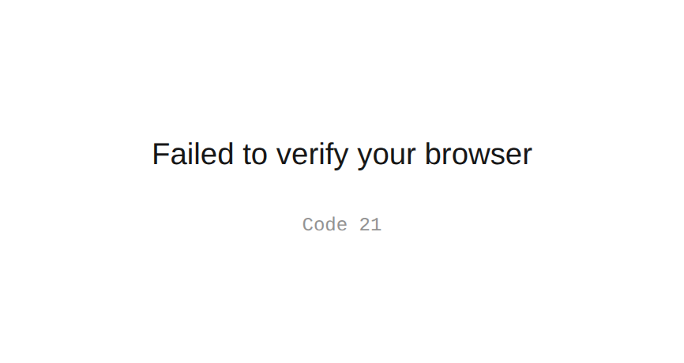

Hi My name is Artyom
==============================================================================================================================

Senior Security Analyst (MDR) | Penetration Tester | Vulnerability Research | EX IADF Officer
--------------------------------------------------------

Senior Security Analyst with over 3 years of hands-on experience in Cyber Security, Incident Investigation, Incident Response, Threat Hunting, and Detection Engineering within an MDR environment. Skilled in both defensive and offensive security, with proven expertise in identifying, investigating, and mitigating threats through incident analysis and proactive threat hunting. A practical Penetration Testing background enables a holistic approach combining incident response with adversarial simulation for robust organizational protection.

I lead investigations into high-severity incidents, mentor a 14-analyst SOC team, and serve as a Red Team member running adversary-simulation exercises against our own detection stack.

Beyond the SOC, I work hands-on in offensive security and independent vulnerability research — including three reserved CVEs from firmware research — bringing a real attacker's perspective to defensive work.

Strong leadership foundation from 5 years as an officer (Captain) in the Israeli Air Force.

Core strengths:
1) Advanced threat detection, incident response, and comprehensive investigations
2) Offensive security & penetration testing (Web, Network, IoT/OT, WiFi)
3) Deep experience with SIEM (Splunk, ArcSight), EDR (CrowdStrike, Microsoft Defender), and security analytics platforms (Elastic & Kibana)
4) AI-driven security automation — local LLMs, alert triage, and enrichment
5) Team leadership and cross-functional collaboration

Driven by continuous learning and innovation, I aim to bridge defensive expertise with offensive penetration testing skills to deliver holistic cybersecurity solutions.
* ✉️  You can contact me at [artmbordulev@gmail.com](mailto:artmbordulev@gmail.com)
* 🤝  I'm open to collaborating on Cyber projects / Cyber investigation / security research

### Try Hack Me

  

### Skills
<!-- Skills – icons only -->

  <!-- SIEM / EDR -->
  
  
  
  
  

  <!-- Offensive -->
  
  
  

  <!-- Cloud / Infra / Automation -->
  
  
  
  
  
  

